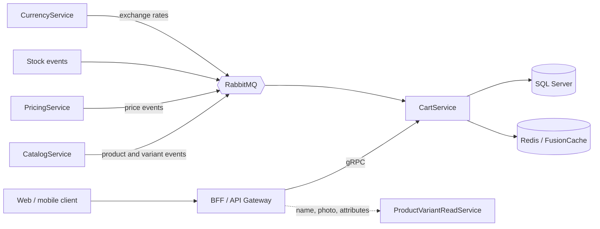
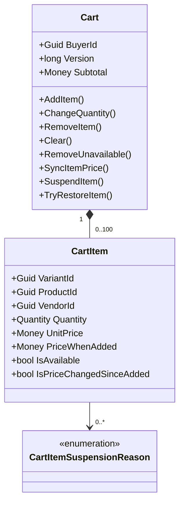
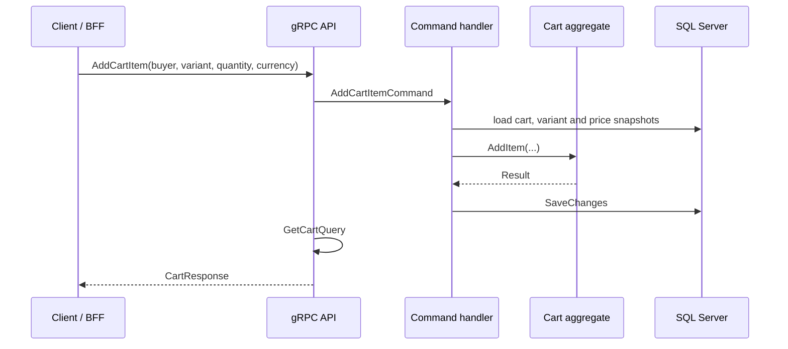

# CartService

Shopping cart microservice of **MigApp**, an e-commerce marketplace platform built on microservices and CQRS.

CartService owns one thing: the buyer's cart. It stores which product **variants** a buyer wants, in what quantity, at what price, and whether each line can still be bought. It does not reserve stock and does not create orders.

## Contents

- [Responsibilities](#responsibilities)
- [Architecture](#architecture)
- [Tech stack](#tech-stack)
- [Solution layout](#solution-layout)
- [Domain model](#domain-model)
- [How it works](#how-it-works)
- [gRPC API](#grpc-api)
- [Currency handling](#currency-handling)
- [Persistence](#persistence)
- [Caching](#caching)
- [Observability](#observability)
- [Getting started](#getting-started)
- [Design decisions](#design-decisions)
- [Roadmap](#roadmap)

## Responsibilities

| CartService does | CartService does not |
|---|---|
| Keep one active cart per buyer | Reserve or decrement stock (done at order creation) |
| Add, change, remove and clear items (one line per product variant) | Create or pay orders |
| Track price changes since an item was added | Own product data such as names, photos and attributes |
| Mark items unavailable and explain why | Decide prices (PricingService does) |
| Return the cart with totals in the buyer's display currency | Charge in any currency other than the system currency (USD) |

## Architecture



CartService follows Clean Architecture with CQRS:

- **Writes** go through the `Cart` aggregate and EF Core.
- **Reads** use a dedicated read repository and read DTOs, never the aggregate. The repository queries the same `DbContext` with `AsNoTracking` projections.
- **Other services' data** arrives as integration events and is kept in local snapshots, so the cart never calls other services on the hot path.

## Tech stack

| Area | Technology |
|---|---|
| Runtime | .NET (see `global.json` / `TargetFramework`) |
| API | gRPC (`cart.v1`) |
| CQRS | MediatR with validation and tracing pipeline behaviours |
| Writes | EF Core, SQL Server |
| Reads | EF Core (`AsNoTracking` projections into read DTOs), SQL Server |
| Messaging | MassTransit over RabbitMQ |
| Cache | FusionCache (memory + Redis, backplane) |
| Observability | OpenTelemetry (traces, metrics), Serilog (JSON logs) |
| Errors | `Result` pattern with error codes, no exceptions for business failures |
| Shared code | `migApp.Shared` (results, value objects, behaviours, caching, gRPC helpers) |

## Solution layout

```text
CartService
├── CartService.Domain           Aggregates, entities, value objects, domain events, errors
├── CartService.Application      Commands, queries, integration event handlers, DTOs, interfaces
├── CartService.Infrastructure   EF Core configurations, repositories, messaging, cache, DI
└── CartService.Api              gRPC services, proto files, mappers, Program.cs
```

Dependencies point inwards: `Api → Application → Domain`, and `Infrastructure → Application`.

## Domain model



**`Cart`** is the aggregate root. There is one cart per buyer. It owns its items and protects the invariants below. It carries a `Version` used for optimistic concurrency and raises a domain event for every change.

**`CartItem`** is one line, identified by `VariantId` inside the cart. It stores only what the cart needs for business rules: variant, product and vendor ids, quantity, the last known unit price, the price at the moment of adding, and a set of suspension reasons.

**Value objects:** `Money` (amount plus currency, always non-negative, validated against the currency's minor units), `Quantity` and `Currency`.

### Business rules

- A cart holds at most `Cart.MaxDistinctItems` (100) distinct variants.
- Adding a variant that is already in the cart increases its quantity instead of creating a duplicate line.
- Quantity is validated by the `Quantity` value object, including the per-item upper limit.
- An item is **available** only when it has no suspension reasons. Unavailable items cannot be increased or changed, only removed.
- **Suspension reasons are a set**, not a single status. Each source (product visibility, variant visibility, stock) adds or removes only its own reason, so a product becoming visible again never hides the fact that the variant is out of stock.
- The subtotal and the totals count only available items.
- `IsPriceChangedSinceAdded` compares the current price with the price the buyer saw when adding, in USD, so exchange-rate movement is never reported as a price change.
- Domain methods receive the current time as a parameter and never call `DateTime.UtcNow`.

## How it works

### Write path



Command handlers return only a `Result`. The API layer then runs `GetCartQuery`, so every mutation answers with the fresh cart (same database, so it reads its own writes). Totals, availability and price-change flags are always computed on the server.

### Read path

1. The read repository loads the cart and its lines in USD minor units with an `AsNoTracking` projection straight into read DTOs, without materialising the aggregate.
2. The read DTO is cached per buyer (see [Caching](#caching)).
3. The mapper converts prices to the requested display currency and computes line totals and totals.
4. If the exchange rate is unavailable, the cart is returned in USD and `Totals.Currency` says so.

Names, photos and attributes of variants are **not** part of this response. The BFF composes them from `ProductVariantReadService`, using the variant ids in the cart.

### Integration events (inbound)

CartService keeps local snapshots so it can validate and update carts without calling other services.

| Source | What changes in CartService |
|---|---|
| CatalogService | Product and variant snapshots (visibility), suspension reasons on affected cart items |
| PricingService | Price snapshots, `UnitPrice` of cart items |
| Stock events | Out-of-stock suspension reason on affected cart items |
| CurrencyService | Exchange rates in the cache |

Snapshot handlers are **idempotent and version-guarded**: an event whose `Version` is not newer than the stored one is ignored and counted in a metric. An event for a snapshot that does not exist yet raises `SnapshotNotFoundException` so the broker retries it later.

## gRPC API

Contract: `Grpc/V1/Protos/cart.proto`, package `cart.v1`.

| RPC | Purpose |
|---|---|
| `GetCart` | Return the cart in the requested currency (empty cart if none exists) |
| `AddCartItem` | Add a variant or increase its quantity |
| `ChangeCartItemQuantity` | Set a new quantity for an item |
| `RemoveCartItem` | Remove one item |
| `RemoveUnavailableCartItems` | Remove all unavailable items |
| `ClearCart` | Remove everything |

Every RPC takes `buyer_id` and a `currency` code, and returns `CartResponse`:

```text
CartResponse
├── cart_id
├── items[]   variant_id, product_id, vendor_id, quantity,
│             unit_price_minor, line_total_minor, price_when_added_minor,
│             is_price_changed, is_available, suspension_reasons[]
└── totals    distinct_items, total_quantity, subtotal_minor, currency
```

All money values are integers in **minor units** of the response currency (cents, grosze, and so on).

Business failures are returned as `Result` errors with stable error codes and translated into gRPC status codes by a server interceptor. Clients should rely on the error code, not on the message.

## Currency handling

- The **system currency is USD**. Prices are stored and validated in USD only.
- A buyer can view the cart in another supported currency. This is **display only**: CartService converts at read time using the current rate.
- OrderService must re-validate prices and charge in the system currency. Converted amounts in the cart are informative (approximate) and are never a source of truth for payment.
- Conversion order: unit price is converted first and rounded, then multiplied by quantity, so `unit × quantity = line` always holds on screen and the subtotal equals the sum of the lines.
- Exchange rates are cached for an hour with fail-safe, so a short outage of the rate source does not break the cart. If no rate is available, the cart falls back to USD.

## Persistence

SQL Server, schema `CartWrite`.

| Table | Notes |
|---|---|
| `Carts` | Unique index on `BuyerId`. `Version` is the concurrency token. |
| `CartItems` | Unique `(CartId, VariantId)`. Indexes on `ProductId` and `VariantId` for snapshot synchronisation. Prices are stored as `bigint` USD minor units. Suspension reasons are stored as a primitive collection. |

Product, variant and price snapshots live in their own tables and carry the source `Version`.

Writes use EF Core and the aggregate. Reads go through the same `DbContext` but bypass the aggregate: `AsNoTracking` queries project straight into read DTOs.

## Caching

FusionCache with a memory layer, Redis as the distributed layer and a Redis backplane. The cache has its own name so that backplane channels do not collide with other services sharing the same Redis.

- **Cart read DTO**: cached per buyer **in USD**, under one key. The display currency is applied after the cache, so one entry serves every currency. The entry must be invalidated after every successful change to the cart, including changes made by snapshot synchronisation.
- **Exchange rates**: cached for one hour with fail-safe enabled.

Cache hits and misses come from FusionCache's own OpenTelemetry instrumentation.

## Observability

- **Traces and metrics:** OpenTelemetry (ASP.NET Core, HTTP client, FusionCache, MassTransit, runtime), exported over OTLP.
- **Application metrics:** `ICartMetrics` for things the infrastructure cannot see, for example outdated or missing snapshots.
- **Logs:** Serilog, JSON to the console and OTLP, enriched with service name, machine name and thread id.
- **Health:** gRPC health checks for SQL Server, Redis and RabbitMQ.

## Getting started

### Prerequisites

- .NET SDK (version from the repository's `global.json` or project files)
- SQL Server, Redis and RabbitMQ (use the Compose file below for local development)

### Local infrastructure

```yaml
# docker-compose.yml (example for local development only)
services:
  sqlserver:
    image: mcr.microsoft.com/mssql/server:2022-latest
    environment:
      ACCEPT_EULA: "Y"
      MSSQL_SA_PASSWORD: "<strong-password>"
    ports: ["1433:1433"]

  redis:
    image: redis:7
    ports: ["6379:6379"]

  rabbitmq:
    image: rabbitmq:3-management
    ports: ["5672:5672", "15672:15672"]
```

### Configuration

Use user secrets or environment variables for anything sensitive.

```json
{
  "ConnectionStrings": {
    "Database": "Server=localhost,1433;Database=CartService;User Id=sa;Password=<strong-password>;TrustServerCertificate=True",
    "Redis": "localhost:6379",
    "OtlpEndpoint": "http://localhost:4317"
  },
  "RabbitMQ": {
    "Host": "localhost",
    "Port": 5672,
    "VirtualHost": "/",
    "Username": "<username>",
    "Password": "<password>"
  }
}
```

The service validates this configuration on startup and fails fast with a clear message if a required value is missing.

### Run

```bash
# apply migrations
dotnet ef database update \
  --project src/CartService.Infrastructure \
  --startup-project src/CartService.Api

# start the service
dotnet run --project src/CartService.Api
```

Adjust the project paths to match the repository layout.

### Tests

```bash
dotnet test
```

## Design decisions

**No stock reservation in the cart.** Most carts are abandoned, so reserving on add would block real sales. The cart does a soft check for the buyer's convenience; the authoritative check and the reservation happen when the order is created.

**Suspension reasons instead of a status enum.** With one status, restoring a product to "available" could overwrite an out-of-stock state. A set of reasons makes each event independent of the order in which events arrive.

**Local snapshots instead of synchronous calls.** The cart keeps working when other services are slow or down, and checks stay in one database. The price is eventual consistency, which the checkout re-validation covers.

**USD storage, display-only conversion.** One stored currency means one price per variant and no drift from exchange rates inside the cart. A buyer's currency is a presentation concern and is applied at read time.

**Cache in USD, convert after the cache.** One cache entry per buyer instead of one per buyer and currency, and one invalidation point.

**Commands return `Result`, the API layer returns the cart.** The command side stays free of read concerns, while clients still get the full, fresh cart in one round trip.

**Product details come from the read service, not from the cart.** Names and photos live in one place and cannot drift. The BFF composes them, and variants hidden from the public simply come back without details and are shown as unavailable.

## Related services

| Service | Relationship |
|---|---|
| CatalogService / ProductVariantReadService | Source of product and variant data, and of display details used by the BFF |
| PricingService | Source of variant prices |
| CurrencyService | Source of exchange rates |
| OrderService | Consumes the cart at checkout and re-validates prices and stock |
